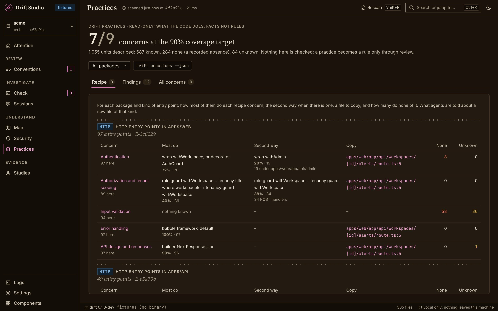
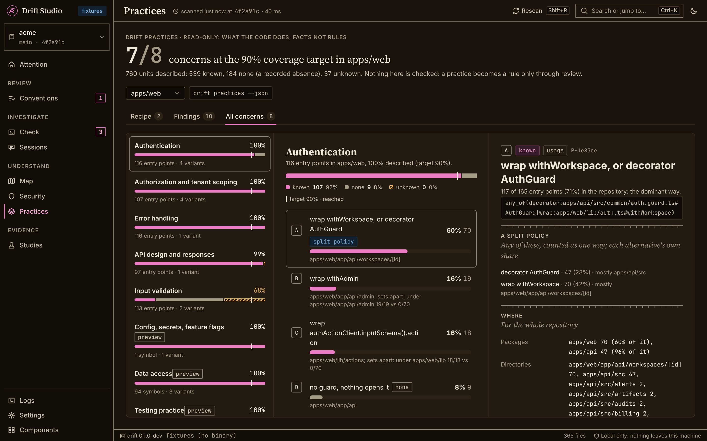

# Drift Studio

A desktop app for people to see what Drift knows about a codebase and what
coding agents did in it: review proposed conventions, investigate violations
and agent sessions, and understand the codebase's shape, boundaries and
security surface. Design: [docs/DESIGN.md](docs/DESIGN.md).


| | |
| --- | --- |
|  |  |
|  |  |
|  |  |

More in [docs/screenshots/](docs/screenshots/) (every view, light and dark,
the code drawer, the command palette and the component gallery).

## Run

From the repository root (an npm workspace with `packages/ui` and `apps/studio`):

```sh
npm ci
npm run start -w drift-studio          # build and open the desktop app
npm run dev -w drift-studio            # the renderer in a browser, on fixtures
```

The desktop app needs the `drift` binary with `census --json` (Drift from this
branch or newer). It is the one chosen in Settings, else the one a packaged build
carries (see Packaging), else the first on `PATH` (and in `~/.cargo/bin`). When
none is found, every view says where it looked and to install Drift or choose
the binary in Settings. The Studio runs it without a shell, so on Windows it runs `drift.exe`:
the `drift.cmd` that npm installs is followed to the `drift.exe` in Drift's
per-platform package, never executed (Node refuses `.cmd` without a shell since
CVE-2024-27980).

## Packaging

```sh
npm run build -w drift-studio
node apps/studio/scripts/package.mjs --linux --drift <path to drift>                 # AppImage and deb
node apps/studio/scripts/package.mjs --mac --drift mac-arm64=<drift> --drift mac-x64=<drift>   # dmg and zip
node apps/studio/scripts/package.mjs --win --drift <path to drift.exe>               # NSIS installer
node apps/studio/scripts/package.mjs --linux --dir --drift <drift>                   # unpacked only, for the live test
```

The packager is [electron-builder](https://www.electron.build), configured by
`scripts/package-config.ts` (unit-tested in `tests/unit/package-config.test.ts`):
app id `io.github.dadbodgeoff.drift-studio` (`STUDIO_APP_ID` overrides it),
product name Drift Studio, `asar` on, Electron fuses set (no `ELECTRON_RUN_AS_NODE`,
no `NODE_OPTIONS`, the app only from its asar), no file associations or protocols,
and no publish target, so there is no update feed and no `app-update.yml`. The
window's sandbox, context isolation and CSP are those of `electron/main.ts`,
unchanged. electron-builder is pinned, with its whole dependency tree, in
`packager/` (its own `package.json` and `package-lock.json`, outside the
JavaScript workspace so the app's lockfile and overrides do not apply to it). CI
installs it with `npm ci --prefix apps/studio/packager --ignore-scripts`
and passes it as `ELECTRON_BUILDER=<its cli.js>`; locally, do the same
(`ELECTRON_BUILDER=apps/studio/packager/node_modules/electron-builder/cli.js`).

**The drift binary is bundled.** Each package carries its platform's `drift` as
an extra resource (`<resources>/bin/drift`, `drift.exe` on Windows), and the
script refuses to build without one. A person who downloads the Studio has a
working app without installing anything else, and the binary is the one this
Studio was built and tested against: the views check schema versions, and an
older `drift` on `PATH` would make them refuse. Settings still overrides it, and
from source the Studio uses `PATH` as before. The Studio never writes the
binary's path anywhere (it does not install agent hooks), so the bundled path
inside an app bundle never ends up in a repository.

**Unsigned by default.** Without signing variables the build succeeds and every
artifact is named `drift-studio-<version>-<os>-<arch>-unsigned.<ext>` (macOS
signed but not notarised: `-not-notarised`). Linux packages are not code-signed.
`release/out/SHA256SUMS` lists the installers. CI (`.github/workflows/studio-package.yml`)
builds the Linux package on every pull request that touches `apps/studio/**` or
`packages/ui/**` and uploads it as the `studio-linux-x64` artifact; macOS (arm64,
x64) and Windows (x64) run nightly and on demand.

### What the first signed release needs (owner)

Signing is configuration: the workflow and the script read these, and nothing
else changes.

| Platform | What | Environment variable (workflow secret) |
| --- | --- | --- |
| macOS | A Developer ID Application certificate, exported as .p12 (base64) | `CSC_LINK` (`MAC_CSC_LINK`), `CSC_KEY_PASSWORD` (`MAC_CSC_KEY_PASSWORD`); or `CSC_NAME` for a keychain identity |
| macOS | Notarisation: an App Store Connect API key (.p8) | `APPLE_API_KEY` (a path; the workflow writes `APPLE_API_KEY_P8` to a file), `APPLE_API_KEY_ID`, `APPLE_API_ISSUER`; or `APPLE_ID`, `APPLE_APP_SPECIFIC_PASSWORD`, `APPLE_TEAM_ID` |
| Windows | An Authenticode code-signing certificate (.pfx, base64) | `WIN_CSC_LINK`, `WIN_CSC_KEY_PASSWORD` |
| all | A release build: refuses to build unsigned, closes the inspector fuse | `STUDIO_RELEASE=1` |
| all | The bundle id, fixed for ever after the first signed release | `STUDIO_APP_ID` (default above) |
| Linux | The deb's Maintainer field | `STUDIO_DEB_MAINTAINER` (default `Drift maintainers`) |

To release it, add a job to `release.yml` after `build`:
`uses: ./.github/workflows/studio-package.yml` with `with: {sign: true}` and the
secrets above, then attach the `studio-*` artifacts to the GitHub Release.

**Auto-update is not built.** No updater is in the app and no feed is
configured. Shipping one needs the owner to choose a feed (GitHub Releases, which
electron-updater reads from `latest*.yml` files the packager writes when a
`publish` provider is set, or a static server they run), a signed build on macOS
and Windows (both updaters refuse unsigned updates), and then `electron-updater`
as a dependency with a `publish` entry in `scripts/package-config.ts`. Until then
a new version is a new download.

Other owner items: an app icon (`packaging/icon.icns`, `icon.ico`, `icons/*.png`;
today the packager uses Electron's default).

## Test

```sh
npm run typecheck --workspaces
npx eslint .
npm test --workspaces                  # vitest: tokens, contrast, CVD, data layer, IPC, main process
npm run e2e -w drift-studio            # Playwright + Chromium on the fixture build, axe on every view
DRIFT_BIN=<drift> xvfb-run -a node apps/studio/tests/e2e/live.mjs   # the real Electron app and drift, live
node apps/studio/tests/e2e/run.mjs --screens   # also writes docs/screenshots
```

Fixtures (`fixtures/`) are produced by the real binary:

```sh
node scripts/make-fixtures.mjs --drift <drift> --work <scratch>          # acme: committed (step 1 from scripts/acme-seed)
node scripts/make-round11-fixtures.mjs --drift <drift> --work <scratch>  # beacon, quiet, broken: committed
node scripts/make-harbor-fixtures.mjs --drift <drift> --work <scratch>    # harbor: committed (standing, advice, --top, unreached, guard unknown, the baseline)
node scripts/make-promote-fixtures.mjs --drift <drift> --work <scratch>  # acme and quiet funnel, acme promote list and runs: committed (after the two above)
node scripts/make-study-fixtures.mjs [--drift <drift> --eval-repos <dir> --work <scratch>]
node scripts/make-local-fixtures.mjs --drift <drift> --repos <dir> --work <scratch>  # twenty, dub: git-ignored
node scripts/make-local-fixtures.mjs --drift <drift> --repos <scratch copies> --work <scratch> --policy <names>  # also policy and check
node scripts/make-screens-fixtures.mjs --drift <drift> --work <scratch>  # fixtures/screens: from-map, upgrade, feedback marks (after make-fixtures)
```

`fixtures/acme/practices.json` is the exception for now: hand-written in the shape the engine prints
(`drift practices --json` version 1 with `recipes` and `findings`) from acme's own security inventory and
sources (variant ids are placeholders), until a release build of the engine regenerates it; so is
`fixtures/quiet/practices.json`. Their variant ids are not those of `acme/promote-runs.json`, which the real binary
wrote: the recorded promotions are reached from the May be promoted tab. `acme` is a synthetic monorepo written by `scripts/synth-repo.mjs` (ours,
Apache-2.0) plus Drift's own parser fixtures; its sessions are synthetic
transcripts whose hook messages and session state come from running
`drift hook claude` as the agent works. No third-party code or real
transcripts are committed; large repositories are generated locally for
performance work and the tests skip them when absent.

## Architecture

```
renderer (React, sandboxed)  ──named channels──▶  preload  ──▶  main process  ──execFile──▶  drift
  app → features → entities → shared              (names only)   validates (zod),           (JSON on stdout,
  @drift/ui design system                                          reads files Drift writes    files Drift writes)
```

- **A view over the CLI.** Every fact, convention, violation and security
  finding comes from `drift scan --out`, `drift census --json`,
  `drift check --format json`, `drift security --json`, `drift practices --json`, `.drift/conventions.yaml`,
  `drift.lock` and `.drift/cache/sessions/*.json`. The Studio aggregates and
  draws; it never analyses code.
- **Renderer** (`src/`): feature-sliced. `shared` (IPC contract, API, i18n,
  libs), `entities` (Drift's data and its hooks), `features` (one per view),
  `app` (shell). ESLint enforces the direction and that slices are entered
  through their `index.ts`. TanStack Query caches, refreshes in the background
  and cancels (cancellation kills the drift process).
- **Design system** (`packages/ui`, `@drift/ui`): tokens, themes, components,
  charts, code/diff views and a graph canvas; usable without Electron.
- **Main process** (`electron/`): `handlers.ts` implements each channel and is
  unit-tested without Electron; `main.ts` wires windows, the protocol and IPC.
- **Performance**: cached slim facts paint first and a scan refreshes in the
  background; the map aggregates to at most 40 children per expanded node and
  600 edges, lays out in a web worker (ELK), and renders only visible nodes.

## Security model

- Renderer: `contextIsolation`, `sandbox`, no `nodeIntegration`; served from
  `studio://app` with a strict CSP (`script-src 'self'`, no inline script or
  style, no eval, no remote origins); no navigation away, no new windows, no
  webviews, every permission request denied.
- IPC: the preload exposes only `invoke(<channel name>)` for the names in
  `src/shared/ipc/names.ts`, an IPC version and push events. The main process
  checks the sender's origin and validates every request with the contract's
  zod schemas before doing anything. The renderer validates every response.
- Running drift: `execFile` (no shell), argv built from fixed pieces and
  validated ids, a minimal environment, a timeout and an output cap.
- Reading files: a repository must be one the person opened; source reads are
  limited to files the last scan listed, resolved inside the repository (no
  symlinks out), 2 MB at most; transcripts only from `~/.claude/projects` by a
  listed session id; session state only from `.drift/cache/sessions/`.
- Writing: only `drift review` (with a 5 s undo window, block and block --force confirmed),
  `drift init` (confirmed) and `drift security --write-baseline` (confirmed, recorded in the audit
  trail) touch a repository. Exports go to a path the person
  chooses.
- Untrusted text: repository and transcript content is rendered as React text
  nodes; code is tokenized into plain tokens (no HTML); Markdown exports put it
  in code spans or fences; secrets in transcripts are redacted by default.
  ESLint forbids `dangerouslySetInnerHTML`, `innerHTML` and friends.
- Nothing is sent anywhere: no telemetry, no network.

## Data contract with the CLI

| Source | Used for | Checked |
| --- | --- | --- |
| `drift --version` | footer, Settings, provenance | shown |
| `drift census --help` | whether `census --json` exists | feature flag |
| `drift --root R scan --out F` | facts (slimmed by `src/shared/contract/slim.ts`) | `schema_version` ∈ {4, 5, 6, 7, 8, 9, 10, 11} |
| `drift --root R census --json` | proposals, outliers, ranks, member counts, tier and rule kind | `schema` ∈ {1} |
| `drift --root R check --format json [--diff-base REF]` | violations (exit 1 means something blocks), per-convention tier and effective mode (`conventions`), what a diff compared (`diff`) | top-level shape |
| `drift --root R security --json [--diff-base REF]` | entry points, shared-guard gaps, exposure, sinks, leaks, env; with a base, what the change introduces (`guard_gaps`, `unguarded_reaching`, `sinks`, `leaks`, `now_public`, `diff`; exit 0) | top-level shape |
| `drift --root R map --json` | each package's production and test dependencies (Map, package panel) | `schema` and `packages` |
| `drift --root R practices --json` | the practice map, read-only: the recipe per package and kind of entry point, findings, every concern's variants by share, where, what sets each apart, unknown with its config line (Practices) | `version` ∈ {1} |
| `drift --root R review --accept/--reject/--block/--advise IDS`, `--block IDS --force` | decisions (a suggestion blocks only with `--force`, after confirming) | exit code; audit trail |
| `drift --root R init` | first policy | exit code |
| `.drift/conventions.yaml`, `drift.lock` | status, mode, baseline | parsed (yaml) |
| `.drift/cache/sessions/<id>.json` | primed, advised, blocks | zod |
| `~/.claude/projects/<cwd>/<id>.jsonl` | agent transcripts; Drift's hook messages recognised by how they open (pinned to Drift's source by a test) | per-record |
| `eval/study/runs/<run>[/views/<view>]/metrics.json` | study runs: tiers, per-language targets (D1–D4), families | defensive parse |

TypeScript mirrors of every shape are in `src/shared/contract/drift.ts`. What the
Studio does with each Drift feature, and what is in flight, is in
[docs/SYNC.md](docs/SYNC.md).

## Platform notes

- Linux containers running as root must pass `--no-sandbox` to Electron
  (Chromium's rule); the renderer is still created with `sandbox: true`.
- `tests/e2e/live.mjs` launches the desktop app itself (Playwright's Electron
  support) against a real `drift` on a repository it writes and commits in a
  temporary directory (`scripts/synth-beacon.mjs`), after `drift init`: it opens
  the repository through the Open dialog, checks that the conventions queue lists
  every convention `drift init` proposed, that the check view runs, that the
  security view lists the entry points, which binary Settings reports, and that
  the window is sandboxed and isolated. `DRIFT_BIN` names the binary (chosen in
  Settings); `STUDIO_APP` runs a packaged app with the drift it carries instead.
  It needs Electron downloaded (`node node_modules/electron/install.js`, or
  `ELECTRON_OVERRIDE_DIST_PATH`) and, on Linux without a display, `xvfb-run`.
- Not done yet: signing, notarisation and auto-update (see Packaging).
