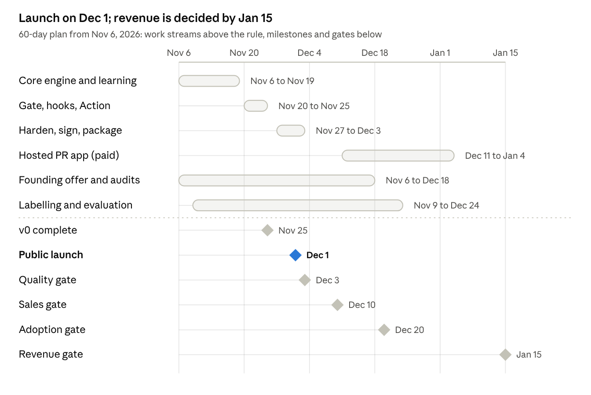
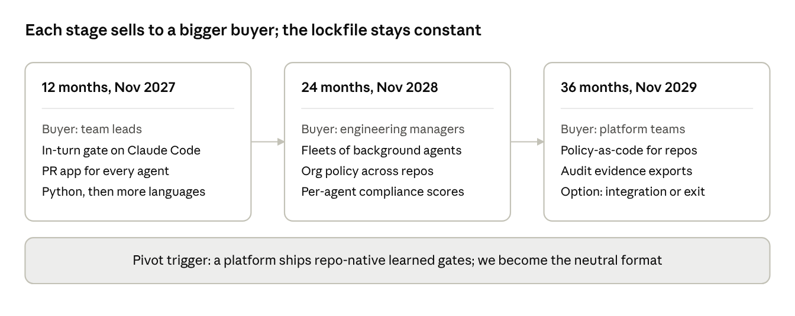

# Drift v2 — Product & Technical Plan

Nov 5, 2026 · @Geoff F

> **Plan of record as of 2026-11-05, kept as written.** It describes what was
> planned, not what ships: some features below do not exist (for example
> `drift init --pr` and `drift upgrade`), and Python support has since shipped.
> The [README](../../README.md) describes the current product. The precision
> targets were made precise later in [`eval/study/README.md`](../../eval/study/README.md)
> (decisions D1–D7): under D7 the default tier is TypeScript call wrappers and
> layering only, Python advises only, and the default tier ships as advise until
> it measures ≥ 95% default-tier accept on a held-out set (the release gate).

## Executive summary

**Decision: rebuild Drift as the convention lockfile for AI agents: a deterministic engine that learns the rules a codebase already follows, has a person approve them, and enforces them in every agent.** No predefined rules, no rule packs, no AI in the check path.

**Why now.** Code-graph tools for agents won the navigation market in 2026 (GitNexus and codebase-memory-mcp each near 48k stars). The convention layer is validated by Sonar's Vortex (Sept 2026) but unserved at the developer level: the open tools sit under 100 stars and count library adoption rather than structure. Cursor Bugbot and Copilot Memory learn rules too, but keep them in vendor systems and apply them with AI.

**What makes it different.**

- **Learned, not written:** Drift knows languages and frameworks, not your conventions, until it learns them from your code.
- **Structural:** it learns how code is assembled (wrappers, call order, co-occurring guards), not only which libraries appear.
- **Deterministic and evidenced:** same input, same output, and every finding cites its support ("40 of 43 routes").
- **Enforced in every agent:** advice on each edit, a block at the end of the turn on Claude Code, and a PR check everywhere else. A ratchet means legacy code never blocks anyone.

**What we build first.** TypeScript and JavaScript only, a Rust core built on the oxc toolchain, a CLI, a Claude Code plugin, a pre-commit hook and a GitHub Action. Python waits until after the January revenue gate.

**How it pays for itself in 60 days.** Revenue starts from self-run Convention Audits ($750, refundable) and capped founding memberships ($79 a year), sold to the v1 audience. Audits convert to flat-rate team pilots ($99 a month) on a hosted PR app. Public launch is Dec 1, 2026; the revenue gate is Jan 15, 2027.

**The two numbers that decide it.** Useful precision of the top 15 learned conventions, rated by people other than the builder: below 50% on Dec 3 and we narrow to entry-point invariants. And $1,500 in monthly recurring revenue by Jan 15. This plan survived five adversarial reviews; 22 of their challenges changed it (see the decision log).

## Product requirements

**Drift v2 serves people who let AI agents write most of their code and need that code to follow the team's unwritten rules.** It learns those rules, asks a person to confirm them, and blocks new code that breaks them.

### Problem

- Agents do not inherit a repo's internal conventions: its wrappers, guards, error style and file layout. They write plausible code that ignores them.
- The most important conventions are undocumented and internal (`withTenant()`, `requireAuth`, `BaseJob`). Public-framework linters cannot know them.
- Today teams pay for this with review time, rework, and repeated audit prompts that burn agent tokens.

### Users

| Stage | User | Pain | Buyer |
| --- | --- | --- | --- |
| Now | Teams of 3 to 15 on TypeScript repos of 50k lines or more, using Claude Code, Cursor or Codex | Rework and inconsistent agent output | Team lead; individuals use it free |
| 12 to 24 months | Tech leads at orgs of 10 to 100 devs running background agents | Review bottleneck, drift across repos | Team lead |
| 24 to 36 months | Platform and security teams | Proof that AI changes followed policy | Engineering leadership |

### Positioning

> **The convention lockfile for AI agents: mined from your code, approved by you, enforced in every agent.** Drift knows languages and frameworks, not your conventions, until it learns them from your code.

Security is a demo, not the tagline: "40 of 43 routes call `requireAuth`; these 3 don't." Drift is a guardrail, not a security control, and every such finding is learned, never shipped as a rule.

### Scope

**v0, Nov 6 to 25 (TypeScript and JavaScript, frontend and backend):**

- `drift init`: learn, show evidence, the person accepts or rejects, write `.drift/conventions.yaml` and `drift.lock`.
- `drift census`: learned conventions per role, with support counts.
- `drift example <role>`: the most typical file for a role, to copy from.
- `drift check`: the gate, over staged files, a diff, or named files.
- `drift review` to confirm rules, plus the Claude Code plugin, pre-commit hook, GitHub Action and JSON output.

v0 covers both sides of a TypeScript codebase. **Frontend:** React and Next.js components and pages, such as layout or auth wrappers, `'use client'` boundaries, data-fetching and form patterns. **Backend:** Next.js API routes and server actions, Express and Fastify handlers, and workers, such as auth wrappers, validation before data access, error handling and tenant-scoped database calls.

**v1, Nov 26 to Jan 4:** SARIF, MCP server, AGENTS.md and CLAUDE.md export, the hosted PR app for teams, held-out evaluation and the published benchmark. Python, call-order rules and git direction follow the January revenue gate.

### Non-goals

- No embeddings and no AI anywhere in the check path.
- No predefined rule packs or library lists.
- No source code leaves the machine, ever, in the product.
- No IDE extension, type checker or cross-language call graph before v1.

### Success metrics

| Metric | Target | Why it matters |
| --- | --- | --- |
| Useful precision of the top 15 conventions, rated by non-builders | 50% by Dec 3, 70% target | Proves the learning is real |
| Precision of flagged violations | 90% or more | A noisy gate gets switched off |
| First census, 100k lines | Under 60 s | First-run impression |
| Per-file check, p95 | Under 300 ms | Runs on every agent edit |
| Agent violations per task, with versus without Drift | Published reduction | The launch proof |

**North star:** weekly gated repos, meaning repos where a hook or CI check ran against accepted conventions that week. Precision is the guardrail that keeps the north star honest.

## Technical design

**Drift is a Rust binary built on the oxc toolchain. It turns TypeScript into language-neutral facts, mines conventions per structural role with conservative statistics, and checks new code only against conventions a person has accepted.** Everything after the fact layer is language-neutral, so a new language means a new language parser only.

### Stack decisions

| Decision | Choice | Why |
| --- | --- | --- |
| Core language | Rust, single static binary | Hook latency, no runtime to install, and the best TypeScript analysis libraries are already Rust |
| TypeScript parsing | `oxc_parser` plus `oxc_semantic` | Gives scopes and bindings on day 1; tree-sitter would leave alias and shadowing analysis to hand-write |
| Module resolution | `oxc_resolver` (a port of webpack's resolver) | tsconfig paths, package `exports` and `imports` handled; checked against the TypeScript compiler in tests |
| Git access | `gix` library | Never shells out to `git`, which can run repo-configured commands |
| Storage | Content-addressed fact cache plus SQLite | Unchanged files cost nothing; CI can restore the cache |
| Crates | 4: `drift-core`, `drift-ts`, `drift-mine`, `drift-cli` | Enough boundaries for a solo builder, no ceremony |

Rust is confirmed, chosen above all for memory: no garbage collector, predictable allocation, and the ability to stream a large monorepo without running out of memory.

### Pipeline

1. **Ingest.** Walk the repo respecting `.gitignore`; stay inside the root; hash each file. Exclude generated code by `@generated` and "DO NOT EDIT" headers, `linguist-generated` in `.gitattributes`, extreme line length and near-duplicates.
2. **Language parser.** Parse, resolve, and lower each file to facts.
3. **Semantic adapters.** Small modules for Next.js (app and pages router) and Express or Fastify in v0, tRPC next. They add facts about *how code runs*, such as which exports are HTTP entry points. They never add conventions.
4. **Roles.** Group files by structure only.
5. **Mining.** Find candidate conventions per role, rank them, cap them.
6. **Confirm.** A person accepts, rejects or sets each one to block.
7. **Check.** Evaluate changed files against accepted conventions; compare with the lock.

The adapters are the one place framework knowledge enters. That keeps the promise precise: **Drift knows languages and frameworks; it does not know your conventions until it learns them.**

### Fact model

| Fact | Example it captures |
| --- | --- |
| Symbol | An exported function, class, const or component |
| Import / ReExport | Canonical target after aliases, barrels and `export *` chains |
| Call | Callee canonicalised, including member paths such as `prisma.*.findMany` |
| Wrap | `export const GET = withWorkspace(fn, ...)`, decorators, JSX wrappers, try/catch |
| Arg | Argument position and object-literal keys, such as `requiredPermissions` |
| Directive | `'use server'`, `'use client'`, `export const runtime` |
| EntryPoint | An HTTP method export or route registration (from adapters) |
| GuardedBy | Protection applied by router, middleware chain or builder (from adapters) |
| Dominates | Guard A runs before sink B on every path, and its result is used |

String literal values are stored for matching but are **never echoed to an agent**. Naming-style facts are deferred.

### Roles: structure only, then frozen

- A role is defined by **path template** (dynamic segments abstracted), filename, set of exported names, default-export kind, and package.
- Role features never overlap with convention features. Otherwise the three unguarded routes would form their own role at 100% compliance, and the signal would vanish.
- After `init`, roles are frozen as **declarative selectors** in `conventions.yaml`. `check` never re-clusters.
- A new file that matches no role is reported as unclassified, never passed silently. An agent cannot escape the gate by inventing a directory.
- Tests form their own role family and never count toward production conventions.

### Mining rules

For role R with n members, of which k hold fact f, f becomes a candidate only if all of these hold:

- n is at least 8 to show it, and at least 15 to allow blocking.
- At least one outlier exists. A fact at 100% is shown as documentation, not as a check.
- The 95% Wilson lower bound of k/n is at least 0.75. This replaces the old flat 85%, which was indefensible at n = 8.
- Lift is at least 1.5: f is much more common in R than in the repo overall. This kills `import React` and similar universal facts.

**Alternatives count together.** When different facts fill the same slot, such as `withWorkspace` or `withSession` wrapping an exported handler, they form one variant set. The convention is "wrapped by one of these", and the split is reported.

**Monorepos are mined per package first**, and merged upward only when a homogeneity test passes, so 100/0 splits per package are not reported as a 60/40 split.

**Ranking** (all deterministic):

```latex
\text{score} = LB_{95} \cdot \log_2(1+n) \cdot \min(\text{lift}, 5) \cdot \text{specificity} \cdot \text{outlier quality} \cdot \text{risk}
```

- Specificity: internal symbols 1.0, third-party 0.6, built-ins 0.3.
- Outlier quality: down-weights outliers that are tests, generated, pure re-exports, or untouched for 2 years.
- Risk: 1.5 when the convention dominates a sink (database, network or filesystem calls).
- Redundant rules are dropped (closed itemsets only, at most 3 items). Output is capped at 5 per role and 15 per repo by default.
- Outliers are ranked by an Engler-style z-score, with recent outliers first: new divergence is drift, old divergence may be legacy.

**Deferred past v0:** call-order rules (as "A dominates B" pairs, not free sequence mining) and git direction (about 12 sampled historical snapshots, computed asynchronously outside the census time budget).

### Policy and lock

- Each convention in `conventions.yaml` has a selector, a rule, its evidence, a status (proposed, accepted, rejected) and a mode (advise or block).
- **Only accepted conventions produce violations. Advise is the default; block is opted into per convention.**
- A convention is identified by *who holds it*, not by its text. After an upgrade or a rename such as `requireAuth` to `requireUser`, old and new are matched when their holder sets overlap by 80% or more, and an alias is kept.
- `drift.lock` keys baselined violations by a cascade: package and export name, then role and name, then a structural hash. Line numbers are never used.
- Once a baselined legacy symbol is edited in the convention's region, it must comply.

### Check and performance

- The index persists between runs. A reverse-dependency index re-checks dependants when a barrel, wrapper or `middleware.ts` changes.
- Budgets: census on 100k lines under 60 s; per-file check under 300 ms at p95; parsing alone is about 1 to 3 s per 100k lines.

**Memory.** Each file is parsed into its own arena, lowered to facts, written to the on-disk cache, and freed before the next, so peak memory depends on the largest file and the mining tables, not on repo size. Mining works on integer-coded fact IDs and per-role counts, never on whole syntax trees. Budget: peak memory under 1 GB on a 1-million-line monorepo, tested nightly.

### Determinism

- Ordered maps or a fixed hasher only; no default `HashMap` iteration in output paths.
- Integer counts and rationals during mining. Floats only when rendering, at fixed precision.
- Every walk sorted, every tie broken by canonical ID, parallel results merged in a fixed order.
- Verified across operating systems, thread counts and checkout paths (see Test strategy).

### Agent integration

**Per-edit checks advise; only the end of the agent's turn can block, and only for new violations of conventions a person set to block.** Claude Code's after-edit hook runs after the edit has landed, so it cannot stop anything ([hooks reference](https://code.claude.com/docs/en/hooks)). Flagging every edit mid-refactor would send the agent chasing files that are only temporarily inconsistent.

| Claude Code event | Drift action | Effect on the agent |
| --- | --- | --- |
| Session start | Snapshot HEAD and the hashes of dirty files as this session's baseline; refresh the index in the background if stale; one short line of context | None |
| Before an edit | Deny edits to `.drift/**`. For a new file in a known role, add that role's top 3 accepted rules and an example path, once per role per session | Denies only `.drift/**` |
| After a batch of edits | Check touched files for new violations; silent when clean; each finding reported once per session | Advice only |
| End of turn | New violations since the session baseline, of conventions in block mode | Blocks, with loop guard |
| Subagent end | Advice only | Avoids nested block loops |

**Loop guard.** At most 3 blocks per session. If the violation set has not shrunk since the last block, Drift stops blocking, tells the user which finding is unresolved, and records it for the PR check. Claude Code's own continuation cap resets on every tool call, so it is not enough.

**Safety.** The hook always exits 0 with JSON, so a crash is never mistaken for a block. Timeout 10 s, fail open. The hook path never runs mining: with no conventions it does nothing and says so once.

**Bypass is expected and visible.** Suppressions use `// drift-ignore <ID>: <reason>` and are listed in the end-of-turn summary and the PR check. `.drift/` is owned through CODEOWNERS, so lock growth or new suppressions need human approval in CI. Shell commands can get past a local hook; CI is the backstop.

**Message to the agent** (about 100 tokens per finding, at most 5 per message):

```
drift: 1 new violation (blocks end of turn). Legacy code is baselined; fix only these.
[D-7f3a] api-route handlers are wrapped in withAuth() — 40/43 files in role api-route
  at   src/app/api/invoices/route.ts:12  export async function POST (unwrapped)
  like src/app/api/orders/route.ts:8     export const POST = withAuth(async (req) => …)
  fix  wrap the handler in withAuth(...)
  if intentional: `// drift-ignore D-7f3a: <reason>` above line 12 (shown to reviewers)
```

**Agent coverage, honestly stated.** In-turn enforcement works on Claude Code. Everywhere else, including background and cloud agents, enforcement happens at commit and PR time. Order of work:

1. Claude Code plugin
2. pre-commit hook and GitHub Action, both in v0
3. Codex hooks
4. Cursor end-of-turn hook
5. MCP for everything else

**MCP tools**, all read-only: `drift_rules_for(path)`, `drift_example(path or role)` with excerpts capped at 40 lines, `drift_check(paths or session)`, `drift_explain(id)`. The census stays a human report.

**Concurrent agents.** `drift.lock` is one sorted line per entry with `merge=union`; agents only remove entries, humans add them. Fact caches are shared per user or through CI cache; the SQLite index is per worktree and gitignored.

**Exports.** AGENTS.md and CLAUDE.md get at most the top 10 accepted rules plus example paths, inside generated markers, in a fixed order.

### Confirmation flow (v0)

1. `drift init` scans and records every candidate as *proposed*. Proposed rules only ever advise. It surfaces the top 10.
2. `drift review` shows one card per rule: the rule, its evidence ("40/43"), one example and up to 3 outliers. Keys: accept, reject, skip, accept as advise-only, apply to the whole role. Target under 10 seconds a card and under 10 minutes total.
3. **Just in time:** when a proposed rule would have flagged a real change, the user is told and can accept it with one command.
4. **Teams:** `drift init --pr` opens a pull request with one YAML block per rule; reviewers delete what they reject.

**First five minutes.** `npx drift init` needs no Rust toolchain. On 100k lines: about 90 s to three findings worth reading, then hooks installed and the agent's first turn gets one piece of advice.

## Test strategy and quality gates

**Every capability is written test-first against a small fixture repo, and the learning engine is judged by people other than us on repos we never tuned against.** Ground truth written by the builder is circular, so it never counts as proof.

### Test layers

| Layer | What it proves | Tooling | When it runs |
| --- | --- | --- | --- |
| L0 Unit | Each lowering rule, scorer and matcher behaves | `cargo test` | Every commit |
| L1 Conformance fixtures | One capability per tiny repo (under 20 files): aliased import normalises, barrel resolves, wrapper detected | Language-neutral YAML spec, `insta` snapshots | Every commit |
| L2 Resolution oracle | Our module resolution agrees with the TypeScript compiler | Differential test against `ts.resolveModuleName` on fixtures plus 20 pinned repos; gate at 99% agreement | Every PR |
| L3 Property and metamorphic | The miner finds planted conventions at known support and names planted outliers; file order, checkout path and unrelated files change nothing | `proptest` synthetic repos | Every PR |
| L4 Fuzz | No panic and bounded time on malformed code, parser error nodes, broken YAML or lock files | `cargo-fuzz` | Nightly |
| L5 Mutation | Tests actually catch logic changes in mining and policy | `cargo-mutants` | Weekly |
| L6 Eval harness | Learned conventions are real and useful | See below | Dev set per PR; held-out set at milestones only |
| L7 End-to-end | JSON matches the published schema; recorded hook payloads replay; Action works; lock IDs survive engine upgrades | Schema validator, replay tests, sandbox repo | Every PR |
| L8 Performance | No speed regressions | Instruction-count benchmarks gated at plus or minus 3% per PR; wall-clock and peak memory on one fixed machine nightly | PR and nightly |
| L9 Determinism | Byte-identical output everywhere | Matrix: Linux and macOS, 1 versus N threads, shuffled walk, different checkout dirs and locales; hashes compared | Linux every PR; macOS on main, nightly and on demand |

**Snapshot hygiene.** Output is sorted, path-redacted and readable. Every snapshot change needs a one-line reason in the PR. A schema version bump gets its own regenerate-only PR. Invariants live in property tests, not snapshots.

### Evaluation harness

- **Repos:** 12 pinned TypeScript repos, 8 for development and 4 held out. They cover a Next.js app, a Node API, a monorepo, a library and an internal-framework-heavy codebase.
- **Labellers:** two independent people per repo (paid contractors, volunteers, or audit customers), never the builder.
- **Blind first:** labellers list the conventions they know before seeing Drift's output. That gives recall.
- **Then rate:** each Drift convention is marked *true and useful*, *true but trivial*, or *false*. That gives precision and stops the metric being gamed with obvious rules.
- **Agreement:** Cohen's kappa of 0.6 or higher, or the rubric is revised.
- **No tuning on the held-out set:** thresholds are frozen before it runs. CI gates only on the development set.

### Metrics

| Metric | Definition | Gate |
| --- | --- | --- |
| Acceptance at 10 | Share of the top 10 ranked conventions per repo rated true and useful | 50% or more at day 28, 70% target |
| Blind recall | Share of labeller-listed conventions Drift found | 30% or more at day 28 |
| Violation precision | On a corpus of agent-written diffs, flagged violations that reviewers confirm | 90% target; measured on new edits only |
| False blocks per agent session | Hook blocks a reviewer judges wrong | Tracked from v0 |
| Time to confirm | Minutes for a person to finish `drift init` | Under 10 minutes |
| Convention churn | Conventions that change between consecutive commits | Near zero |

**Post-launch north star:** accepted, non-trivial conventions that caught at least one real violation in agent edits, per active repo. Acceptance at 10 stays as the quality guardrail.

### Agent benchmark (launch proof)

- **Tasks:** 20 to 30 rebuilt from real merged PRs across 5 repos: revert the change and use its issue as the prompt.
- **Four arms:** no Drift; a `/init` CLAUDE.md; Drift's exported AGENTS.md only; Drift hooks.
- **Runs:** three or more per arm, with pinned model and CLI versions.
- **Grading:** two reviewers, blind to the arm, against a rubric written in advance.
- **Publication:** hypotheses registered up front; harness, transcripts, raw data and the tasks where Drift lost all published.
- **Cost:** about 360 runs, roughly $500 to $1,500.

## Production readiness

**"Production ready from day one" means safe to install, safe to run on hostile repos, and safe with customer data.** Feature polish, uptime promises and a cloud tier come later. The biggest risks sit outside the code: the audit service and the hook's output.

### Threat model, and the rules that answer it

| Threat | Rule |
| --- | --- |
| Hook output becomes the agent's context, so code can carry instructions (prompt injection) | Structured JSON only. Identifiers escaped and capped at 64 characters. String literals and comments never echoed. Repo-derived text is labelled as untrusted content. |
| The agent edits its own gate | Any agent edit to `.drift/**` is a block. In CI the lock may only shrink unless a code owner approves. |
| A malicious repo attacks the parser | No symlinks out of the repo root. Path escapes refused in tsconfig and package.json resolution. Never shell out to `git` (use the `gix` library). No commands allowed in config. |
| Resource exhaustion | Limits: 1 MB per file, a file count, AST depth, parser cancellation, a time budget per file, capped rule-mining size. |
| Drift crashes mid-session | The hook fails open with a loud warning. CI fails closed only with `--strict`. |
| A compromised release | Publishing only from CI (see below), never from the laptop where agents run. |

The gate is positioned as a **guardrail plus CI ratchet, not a security control.** An agent or person can bypass a local hook, and we say so.

### Day 1, before the first audit or package

- [ ] **Audits are customer-run by default.** The customer runs `drift census --json` and shares the output; we review on a call. Hands-on code access is an upsell.
- [ ] When we do touch code: one throwaway VM per customer, read-only deploy key, never run the repo's scripts or installs, no AI model on their code without written opt-in, everything deleted within 14 days with written confirmation.
- [ ] Templates: mutual NDA, short statement of work and data-processing terms, liability capped at fees paid, "not a security audit or penetration test".
- [ ] Audit data is never reused for evaluation without a written clause, and then only as derived, anonymised labels.
- [ ] A company entity, and quotes for professional liability and cyber insurance.
- [ ] Reserve one consistent package name for Drift on npm, crates.io and Homebrew, plus the GitHub org and domain; the bare name is likely taken on registries. Post a notice on v1's repo and packages pointing to v2.
- [ ] Repo hardening: 2FA everywhere, protected branches and tags, SECURITY.md with private vulnerability reporting, CONTRIBUTING (no DCO sign-off: maintainer decision, PR #1), code of conduct, Apache-2.0 licence.
- [ ] A written disclosure policy for anything found in public repos: verify by hand, report privately, wait 90 days or until fixed, never name a project without consent.
- [ ] Billing: a merchant of record for subscriptions (handles VAT and sales tax), plain invoices for audits, a 14-day refund window.

### By day 21, the v0 release

- [ ] Releases from CI only: OIDC trusted publishing to npm (with provenance) and crates.io, build attestations, keyless signatures, checksums, and a manual approval step.
- [ ] npm distribution through per-platform packages with **no install scripts**.
- [ ] Supply-chain gates: dependency advisory and licence checks, Actions pinned by commit hash, pinned toolchain, locked builds.
- [ ] Targets: macOS arm64 and x64, Linux x64 and arm64. Windows through WSL for v0; CRLF and case-insensitive paths still tested.
- [ ] Cross-platform stable fingerprints: path separators, Unicode NFC, line endings normalised.
- [ ] A hostile-identifier test corpus for hook output sanitisation.
- [ ] Separate versions for the CLI, the JSON schema, the config format, the lock format and the fact cache. The lock pins the engine; only `drift upgrade` re-learns. Pre-1.0 breaking changes are always announced in the changelog.
- [ ] **No telemetry in v0.** A consent prompt cannot work inside hooks or CI.

### By day 60

- [ ] Nightly fuzzing and the cross-OS determinism matrix.
- [ ] Hosted report: an allowlisted upload schema, identifiers replaced by keyed hashes whose key never leaves the machine, no author names, `--dry-run` shows exactly what is sent, an explicit flag on every upload. Badges show adoption only, never gap counts. The CLI never depends on the cloud.
- [ ] Privacy policy, subprocessor list, deletion on request.
- [ ] Offline signed licence files (Ed25519) with a 30-day grace period. A licence problem never breaks `check` or CI. We do not invest in anti-bypass: the moat is the hosted team features.
- [ ] Support by email and GitHub Discussions: replies within 2 business days for Pro, 1 for Team. No uptime SLA during pilots.
- [ ] A deprecation policy (two minor versions of warnings) and tested lock migrations.

### Later

Reproducible builds, SLSA level 3, Windows and macOS code signing, opt-in telemetry with a published schema, SOC 2 readiness, SSO, real SLAs.

## Go-to-market, pricing and revenue

**We sell "the convention lockfile for AI agents": mined from your code, approved by you, enforced in every agent.** Learning is how it works; a versioned, agent-neutral file in your repo is what people buy. That answers the main complaint about Cursor Bugbot's learned rules, which live in a vendor dashboard rather than the repo ([Cursor](https://cursor.com/blog/bugbot-learning), [forum request](https://forum.cursor.com/t/api-or-git-based-workflow-to-promote-bugbot-learned-rules-into-repository-rules/171018)).

### Who we sell to first

TypeScript repos of **50k lines or more, or with 3 or more contributors**, using Claude Code, Cursor or Codex. Smaller repos have too few files per role to learn from; they still get the free tool.

Individuals install; team leads pay. The free tier is the individual product. The first paid product is the team PR check.

### Free versus paid

| Tier | Price | Includes |
| --- | --- | --- |
| Free, open source | $0 | Everything local: init, review, check, hooks, MCP, exports, the GitHub Action, public repos |
| Founding member | $79 a year, capped at 100 | Early access to the hosted PR app on personal private repos; price held while the subscription stays active; 50% off Team for year one; refund if the app is not live by Jan 15, 2027 |
| Team pilot | $99 a month flat, up to 15 developers, 14-day trial | Hosted PR app with evidence comments, suppression review queue, org-wide policy sync, trend history; annual billing gets two months free |
| Team, later | $15 to $19 per active contributor a month | Same, priced below AI review tools because there is no model cost |
| Enterprise, later | Custom | SSO, audit exports, self-hosting |

The $9 Pro tier is dropped: its features did not justify a subscription. Paid rule packs are dropped: they contradict the product.

### Convention Audit

| Offer | Price | How it works |
| --- | --- | --- |
| Self-run audit | $750 fixed | The customer runs the binary and shares the report; we review it on a 45-minute call and hand over tuned `conventions.yaml`, hook setup and AGENTS.md. Full refund if fewer than 10 conventions are accepted. |
| Hands-on audit | $1,500 | Under NDA, in a throwaway environment (see Production readiness) |

Audits are described as "convention and invariant outliers", never as a security assessment.

### Distribution

- Claude Code plugin directory and community marketplaces.
- The official MCP registry, Smithery, Glama and the Cursor directory.
- GitHub Marketplace listing for the Action.
- A one-line `npx` install in every post.
- **20 free public "convention census" reports** on well-known TypeScript repos, published with maintainers' blessing, plus a leaderboard.
- The published agent benchmark, with its harness.
- Integration with code-graph tools such as GitNexus or codebase-memory-mcp, as their convention layer rather than their competitor.
- Reddit and Hacker News for the launch spike, with the v1 audience notified first.

### Launch and the calendar

- **Launch Tuesday, Dec 1, 2026**, after US Thanksgiving week.
- Close team pilots before Dec 18; the holidays stall purchasing.
- Final revenue gate on Jan 15, 2027, when new budgets open.
- Demo material uses only our own or seeded repos, fixed findings, or findings shown with maintainer consent.

### Revenue targets

| Checkpoint | Target |
| --- | --- |
| Day 35, Dec 10 | 5 paid audits ($3,750) or 30 founding members ($2,370) |
| Day 60, Jan 4 | First 3 team pilots running the gate in CI |
| Jan 15, 2027 | $1,500 or more in monthly recurring revenue, or 3 teams paying past trial |

Infrastructure costs are small because the product runs on the customer's machine. The real constraint is founder income and time, and these targets are set against that.

## Roadmap

**v0 is complete on Nov 25, the public launch is Dec 1, and the paid team product is live before Jan 15, 2027.** Day 1 is Nov 6, 2026.



Bars are work streams and diamonds are milestones; each gate's criteria are in Risks.

### Definition of done, week by week

1. **Nov 6 to 12:** TypeScript parser resolves 99% of imports the same way the TypeScript compiler does. Offer posted to the v1 audience. 12 evaluation repos pinned and labellers recruited. Day-1 production checklist done.
2. **Nov 13 to 19:** roles and mining working; `drift census` with evidence on 3 real repos; blind labels collected for the development set.
3. **Nov 20 to 25:** review flow, check, lock, Claude Code plugin, pre-commit and GitHub Action. **v0 is done when** it runs on all 12 repos without a crash, a 100k-line census takes under 60 s, output is byte-identical on Linux and macOS, a recorded Claude Code session works end to end, `npx` installs in under a minute, and the quickstart is written.
4. **Nov 27 to Dec 3:** fix the top false-positive classes, signed npm release, demo recorded. Launch Dec 1; quality gate Dec 3.
5. **Dec 4 to 10:** launch support, the 20 public census reports, audits. Sales gate Dec 10.
6. **Dec 11 to 17:** SARIF, MCP tools, hosted PR app first version; close team pilots.
7. **Dec 18 to 24:** held-out evaluation and benchmark published with their harness. Adoption gate Dec 20.
8. **Dec 25 to Jan 4:** hardening and buffer. **v1 is done when** the Action and SARIF are live, precision, recall and the benchmark are public, 3 pilots run the gate in CI, and lock migration tests pass.

Python, call-order rules and git direction start after the Jan 15 revenue gate.

### 12, 24 and 36 months



Three things hold at every stage: the convention file lives in the customer's repo, no AI runs in the check path, and source code never leaves their machine. The platform changelogs to watch are Claude Code, Cursor Bugbot and GitHub Copilot.

## Risks, kill criteria and pivots

**The two risks that can end this are that the learning isn't good enough, and that developers won't pay for enforcement.** Each has a dated, measurable gate with a pre-agreed response, so we never drift into building on hope.

### Gates

| Date | Gate | If missed |
| --- | --- | --- |
| Day 28, Dec 3 | Useful precision at 15 of 50% or more, and blind recall of 30% or more, on at least 150 ratings by people who are not the builder | Narrow to entry-point invariants only (guards on routes, handlers and jobs), where the adapters give the strongest signal |
| Day 35, Dec 10 | 5 paid audits or 30 founding members | Stop building features; spend two weeks on interviews to find out why |
| Day 45, Dec 20 | 100 weekly gated repos; day-7 hook retention of 40% or more | Fix onboarding and false blocks before anything new |
| Jan 15, 2027 | $1,500 monthly recurring revenue or 3 teams paying past trial | Run it as a services business, or approach a review or agent vendor about integration or acquisition |

### Leading indicators, tracked weekly

- **Weekly gated repos:** repos where a hook or CI check ran against accepted conventions. This is the north star.
- Day-7 and day-30 hook retention (uninstall is the main churn signal).
- Block-to-self-fix rate: how often the agent fixes a blocked violation without help.
- Override and suppression rate, as a proxy for false blocks.
- Share of installs that finish `drift review`, and time to first accepted convention.

Until opt-in telemetry exists, these come from Action installs, public repos, pilot customers and the benchmark.

### Risk register

| Risk | Likelihood | Mitigation | Watch signal |
| --- | --- | --- | --- |
| Learned conventions are too noisy | High | Wilson bounds, lift, structural roles, top-15 cap, advise by default | Useful precision at 15 |
| A platform ships it natively: Bugbot rules exported into the repo, learned guards in Claude Code, enforcement in Copilot Memory | Medium | Be the agent-neutral file format, with import and export adapters for each | Their changelogs, checked monthly |
| Fast followers: VibeDrift, codebase-context, Pokayoke, arai, graph tools adding a convention layer | High | Published precision, the eval corpus, format adoption, speed | New launches in MCP registries and Show HN |
| Individuals use it free and nobody pays | Medium | Paid product is the team PR app; individuals are the funnel | Day 35 and Jan 15 gates |
| Solo scope overrun | High | Pre-agreed cut list: Python, call order, git direction, hosted badge, native Windows | Weekly definition-of-done review |
| TypeScript module resolution eats the schedule | Medium | `oxc_resolver` plus a compiler oracle; bundler aliases and dynamic imports scoped out | Oracle agreement below 99% after week 1 |
| Customer code liability from audits | Medium | Self-run audits by default, contracts, deletion policy | Any request for code access |
| Agents bypass or tamper with the gate | Medium | `.drift/` edits denied, CODEOWNERS, CI backstop, suppressions surfaced | Suppression rate |
| The name | High | Name kept by founder decision; own its meaning through the lockfile positioning, keep security out of the brand, one consistent package name | Name confusion in search results and launch feedback |
| Holiday stall | High | Launch Dec 1; close pilots by Dec 18; final gate Jan 15 | Pipeline at Dec 18 |

## Review debate and decision log

**Five independent reviewers attacked the first draft, and 22 of their challenges changed the plan.** The lenses were static analysis and mining, market and positioning, agent integration, security and release engineering, and testing and execution. The mining reviewer also tested the security idea on a real Next.js monorepo: only 90 of 134 API routes were guarded, and most of the rest were intentional webhooks and callbacks. The original design would have learned nothing there.

| Challenge | Raised by | Decision | Resolution |
| --- | --- | --- | --- |
| A day-21 quality gate can't be measured on the day v0 ships, and builder-written labels are circular | Testing | Accepted | Gate moved to day 28; non-builder labellers; held-out repos |
| "Acceptance rate" can be gamed with obvious rules | Testing, mining | Accepted | Useful precision at 15 with a three-way rubric, plus blind recall |
| An 85% threshold at n = 8 is statistically indefensible | Mining | Accepted | Wilson lower bound of 0.75 or more, lift of 1.5 or more, n of 15 or more to block |
| Guards applied by routers, configs and wrappers can't be seen without framework knowledge | Mining | Modified | Fact-only semantic adapters; conventions are still never shipped |
| Roles built from shared facts absorb the outliers | Mining | Accepted | Structure-only roles, frozen as selectors |
| tree-sitter gives no scope or binding resolution | Mining | Accepted | oxc parser, semantic analysis and resolver |
| Rust slows a solo builder; TypeScript would do | Testing, market | Modified | Rust with oxc, confirmed by the founder: bounded memory on large repos, and oxc removes the biggest schedule risk |
| Python, call-order rules and git direction don't fit 60 days | Mining, testing, market | Accepted | All deferred past Jan 15 |
| Claude Code's after-edit hook cannot block | Integration | Accepted | Advise per edit; block only at end of turn |
| The built-in loop cap resets on every tool call | Integration | Accepted | Drift's own guard: 3 blocks per session, stop when findings don't shrink |
| Agents can edit their own gate, and hook output can carry prompt injection | Integration, security | Accepted | `.drift/` edits denied, CODEOWNERS, escaped and capped output, no literals echoed |
| Confirmation flow, GitHub Action and pre-commit were scheduled too late | Integration | Accepted | All moved into v0 |
| Blocking at 90% precision means 1 wrong block in 10, and users uninstall | Market, mining | Accepted | Advise by default; block is opted into per accepted convention |
| "Learned" alone no longer differentiates: Bugbot learned rules and Copilot Memory exist | Market | Modified | Lead with the agent-neutral convention lockfile; learning stays the mechanism and the core |
| Small repos need predefined priors to get any output | Market | Rejected | Rejected to protect the core thesis; instead target repos of 50k lines or 3 contributors |
| A solo founder can't get access to customer code, and audit data can't become eval data | Security, market | Accepted | Self-run $750 audit by default; derived labels only with written consent |
| Audits before v0 exists are consulting, not validation | Testing | Accepted | Sold as services; never counted toward quality gates |
| The $9 Pro tier has no pull, and cheap founding seats undercut Team | Market | Accepted | Pro dropped; founding seats capped at 100 and scoped |
| Publishing security gaps clashes with 90-day disclosure, and the security tagline overclaims | Security, testing | Accepted | Positioned as a guardrail; demos use own, seeded, fixed or consented cases |
| Acceptance rate is a quality input, not a north star | Market, testing | Modified | North star is weekly gated repos; precision stays the guardrail |
| A solo founder can't win the compliance market at 36 months | Market | Modified | Plan for integration or acquisition at 12 to 24 months; governance stays an option |
| "Drift" collides with VibeDrift and with the Salesloft Drift breach of 2025 | Market, security | Rejected | Founder keeps the name; mitigations under Open questions |

## Open questions for the founder

**Three decisions were settled on Nov 5; nothing blocks the build.**

### Decided

- **The name stays Drift.** We own its meaning through the lockfile positioning, keep security out of the brand, and use one consistent package name across registries.
- **v1 is not reviewed or reused.** v2 is a clean-slate build from this plan, so none of v1's early patterns carry over. v1 users get a notice pointing to v2.
- **Rust, built by Claude.** Chosen for bounded memory on large monorepos and fast hooks (see Technical design).

Business questions such as the income target, company setup and the hosted app date are parked. They don't shape the codebase and will be settled when they come due.
